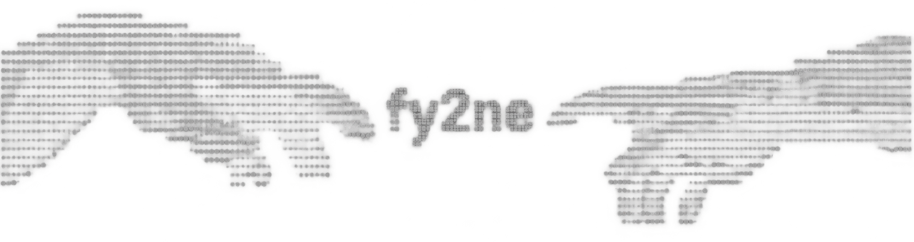

 

  

  Systems infrastructure · AI engineering · CyberSecurity

---

I build systems, tools, and infrastructure at the intersection of low-level engineering and AI.

My work spans GPU-accelerated perception, agent runtimes, browser automation, and protocol engineering.

## Projects

**[VACT](https://vact.fy2ne.me)**  
GPU-accelerated screen perception and IPC for autonomous desktop agents. Uses Direct3D 11 compute shaders to deliver low-latency vector updates.

**[Weavetab](https://github.com/Weavetab)**  
An open-source foundation for AI browser automation, built on Chrome DevTools Protocol with a local-first architecture.

**[Muto](https://github.com/fy2ne/Muto)**  
Developer runtime. Hot-swap mods live with no JVM restart. Built on classloader rotation, live registry thawing, and a JVM agent that hooks before your game even starts.

**[Essential Devs](https://github.com/Essential-Devs)**  
A development collective focused on tools, infrastructure, and systems engineering. 

**[fy2ne.me](https://fy2ne.me)**  
Personal site, technical writing, and engineering notes.

## Stack

`TypeScript` · `Rust` · `C++` · `JavaScript` · `Python` · `Java`

`Node.js` · `React` · `Direct3D 11` · `Cloudflare` · `Chrome DevTools Protocol`

## Links

- [Website](https://fy2ne.me)
- [GitHub](https://github.com/fy2ne)
- [X / Twitter](https://twitter.com/fy2ne)
- [Discord](https://discord.com/users/1165043058715394199)
- [YouTube](https://youtube.com/@fy2ne)
- [Modrinth](https://modrinth.com/user/fy2ne)

